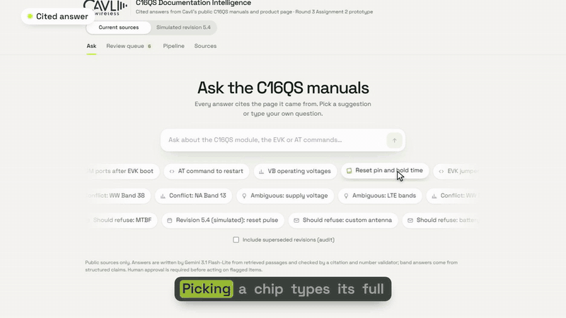

# C16QS Documentation Intelligence

This is the prototype for Cavli Round 3 Assignment 2, AI-Powered Technical Documentation Intelligence. It ingests public technical material for the **Cavli C16QS** LTE Cat 1bis module, retrieves supporting passages, and gives answers cited to document, revision and page or section. It also recognises document versions, ambiguous scope, missing evidence and conflicting sources, and it sends conflicts and revision changes to an expert review queue.

It runs two ways: as a local Python CLI, and as a hosted web prototype.



*A 24-second excerpt from the demo film. The full film is in the submission folder.*

## Hosted prototype

**https://cavli-assignment-2.nishanameenk.workers.dev** — sign in as `reviewer`. The password is in the submission PDF (locally it's `REVIEWER_PASSWORD` in the ignored `.env`).

The page has four tabs:
- **Ask:** suggested questions drift past in rows of prompt chips, one row per case type (answerable; ambiguous and conflicting; should refuse and the simulated revision). Clicking a chip flies it into the question bar and types the full question; press Enter or Send to ask. Answers with a status badge, numbered citations that open the PDF at the cited page, and a panel showing the retrieved passages (keyword coverage, meaning similarity) and the validation result.
- **Review queue:** conflicts, broken cross-references and revision changes, each with its evidence. An expert can mark an item resolved with a note, or reopen it.
- **Pipeline (read-only):** the five stages (acquire, extract, index, check, publish) with real counts, a per-document table, the simulated-revision timeline, ingest and publish run history, and a **"Check sources for updates"** button. The button compares live sources with the fingerprints recorded at publish time (ETag and size for PDFs, visible text for the product page). It only detects change; re-indexing stays in the controlled pipeline, because it needs human approval.
- **Sources:** each indexed revision with its hashes.

The page shares Assignment 1's design: the official Cavli Wireless logo, self-hosted Space Grotesk, and the vividsites Prompt Chips component. Reduced-motion settings hold the chip rows still. While an answer is being checked, a Thinking Orb (Libraries.dev, MIT, unmodified source in `web/vendor/thinking-orbs`, bundled by `web/scripts/build-orb.mjs`) sits under the question bar; smaller orbs mark the other tabs' loading states. With reduced motion the orb is a still frame.

A switch at the top changes from the current sources to the **simulated revision 5.4** view, and an audit option shows superseded passages.

How it's built:
- A Cloudflare Worker (`web/`) runs a TypeScript port of the answer engine. The live default is **hybrid search** (Postgres full text plus Gemini vectors in pgvector, fused with reciprocal rank fusion). The **model judges answerability**: it answers with citations or says "not verified", the validator checks every citation and number, and if the model is unavailable the answer is "not verified". This default was adopted by a rule fixed in advance, after three measured steps; see [`docs/RETRIEVAL-EXPERIMENT.md`](docs/RETRIEVAL-EXPERIMENT.md). Keyword search with a word-overlap pre-filter is still available per request, and is what the local CLI uses.
- The data sits in its own `docintel` schema in the existing Supabase project, reached through a token-checked edge function (`supabase/`).
- `python -m docintel publish` pushes the verified local index to that schema.
- Assignment 1 shares nothing with it except the Supabase project and the Gemini key.

Verified live (answer logic f8d276a4, page 53c29280 after the redesign and loading orb, 15 November 2026):
- main set 13/14: E06 was refused safely during a Gemini timeout; the candidate run before the switch scored 14/14
- held-out set 10/10
- fresh set C 16/16: all 10 answerable questions answered and all 6 unanswerable ones refused (the old default scored 13/16)
- paraphrase sets B 12/12 and A 11/14 (the old default scored 10/12 and 7/14)
- Playwright browser check 18/18 on the redesigned page, desktop and 375 px mobile, including the Pipeline tab.

Current live version: **e66e6454** (16 November 2026). It runs version aa9e149f's code, with a reviewer-password change on top. It adds fixes F21 and F22 from [`docs/FAILURES-REPORT.md`](docs/FAILURES-REPORT.md):
- A validator rejection is no longer reported as an outage.
- Revision labels such as "5.4" pass the number check when written as a revision.
- The model answers from the later revision first.
- The supply-voltage split answer follows the outage rule.

Before deploying, the same sets were re-run on a local Worker against live data: main 14/14, held-out 10/10, C 16/16, B 12/12 and A 11/14. On e66e6454:
- The orb check passed.
- Playwright scored 15/18. The three misses were safe refusals while Gemini returned HTTP 503s; every check that does not need the model passed.

Details are in [`outputs/HOSTED-VERIFICATION.md`](outputs/HOSTED-VERIFICATION.md).

To redeploy, run these from `web/`. The schema migration is in `supabase/migrations/`, and the edge function is in `supabase/functions/cavli-docintel/`.

| Step | Command |
|---|---|
| Install | `npm install` |
| Type-check | `npm run check` |
| Deploy | `npx wrangler deploy` |
| Set secrets | `wrangler secret bulk` with `DOCINTEL_TOKEN`, `GEMINI_API_KEY`, `GEMINI_BACKUP_KEY` (optional) and `DEMO_ACCESS_SECRET` |
| Browser test | `node scripts/browser-check.mjs <url>` |

## Setup (local CLI)

1. Install Python 3.12 or later, then run `pip install -r requirements.txt`. The only dependency is `pypdfium2`; SQLite FTS5 is built into Python.
2. Optional: copy `.env.example` to `.env` and set `GEMINI_API_KEY` to get generated answers. Without a key, everything runs in extractive mode. `.env` is git-ignored and never packaged.
3. Run `python -m docintel ingest`. This downloads the four sources listed in `sources/manifest.json`, checks their SHA-256 hashes, then extracts and indexes them into `cache/index.sqlite` (about 15 s). If a host shows a browser check, as TME sometimes does, open the URL in a browser, save the file into `cache/inbox/` and run ingest again. Hash-matched inbox files are accepted.

## Use

```text
python -m docintel sources                       # inventory: revision, date, status, pages, passages, acquisition
python -m docintel ask "Which pin resets the bare C16QS module?"   [--extractive] [--json] [--all-revisions]
python -m docintel review [--details] [--all]    # expert review queue (conflicts, gaps, revision changes)
python -m docintel review --resolve 4 --note "Confirmed with Cavli PM: ..."   # human sign-off
python -m docintel ingest [--refresh] [--offline]  # idempotent: unchanged text hash means no new revision
python -m docintel --db cache/demo-revision.sqlite simulate-revision   # labelled SIMULATED 5.4 (use a copy of the index)
python -m docintel eval [--extractive] [--cases holdout.json]          # writes outputs/EVALUATION*.md and JSON
python -m docintel inventory                     # writes outputs/source-inventory.json
python -m docintel publish                       # push index (main + simulated view) to Supabase; needs DOCINTEL_* in .env
python -m docintel eval --hosted https://cavli-assignment-2.nishanameenk.workers.dev [--cases holdout.json|paraphrase.json|paraphrase-b.json|paraphrase-c.json] [--retrieval keyword|hybrid|hybrid-gte] [--gate coverage|model]
python scripts/calibrate_semantic.py [gemini|gte]  # similarity thresholds, from cases.json + holdout.json only
```

`publish` also records change-detection fingerprints and embeds new or changed passages. gte-small vectors are made by the edge function; Gemini vectors come from the pipeline, using a content-addressed cache in `cache/gemini-embeddings.json`. The free Gemini tier allows 1,000 embedding requests per day per Google project. If `GEMINI_BACKUP_KEY` (a key from another project) is set, it is used automatically after a quota error, for embeddings and for answers.

## Deliverables

| Brief item | Where |
|---|---|
| Ingestion, retrieval and Q&A prototype | `docintel/` (CLI) and the hosted web prototype (`web/`, `supabase/`) |
| Hosted verification | [`outputs/HOSTED-VERIFICATION.md`](outputs/HOSTED-VERIFICATION.md), [`EVALUATION-hosted-keyword.md`](outputs/EVALUATION-hosted-keyword.md), [`EVALUATION-holdout-hosted-keyword.md`](outputs/EVALUATION-holdout-hosted-keyword.md), [`browser-check-hosted.json`](outputs/browser-check-hosted.json), screenshots in `outputs/browser/hosted/` |
| Retrieval comparison (keyword vs hybrid) | [`docs/RETRIEVAL-EXPERIMENT.md`](docs/RETRIEVAL-EXPERIMENT.md), paraphrase sets `eval/paraphrase*.json`, results `outputs/EVALUATION-paraphrase*.md`, calibration `outputs/semantic-calibration-*.json` |
| Source inventory and metadata sample | [`docs/SOURCES.md`](docs/SOURCES.md), [`outputs/source-inventory.json`](outputs/source-inventory.json), [`sources/manifest.json`](sources/manifest.json) |
| Evaluation table with observed results (at least 8 questions) | [`outputs/EVALUATION.md`](outputs/EVALUATION.md): 14 cases, 14/14. [`outputs/EVALUATION-holdout.md`](outputs/EVALUATION-holdout.md): 10 held-out cases, 10/10. Also [`run 1, before retry`](outputs/EVALUATION-run1-no-retry.md) (13/14) and [`extractive baseline`](outputs/EVALUATION-extractive.md) (10/14). Case definitions are in `eval/`. |
| Failures report and documentation improvements | [`docs/FAILURES-REPORT.md`](docs/FAILURES-REPORT.md) |
| Architecture and validation note (max 4 pages) | [`docs/Cavli_A02_Technical_Note.pdf`](docs/Cavli_A02_Technical_Note.pdf) (4 pages; source `docs/technical-note.html`) |
| Revision re-indexing and conflict flagging | Simulated revision spec in `sources/simulated/`; demo chapter 6; eval case E14 |
| 5–10 minute demo | **Hosted site:** [`outputs/Cavli_A02_hosted_demo.mp4`](outputs/Cavli_A02_hosted_demo.mp4) (5 min 57 s, recorded on 14 November, before the Pipeline tab existed; a new recording is planned). **CLI:** [`outputs/Cavli_A02_demo.mp4`](outputs/Cavli_A02_demo.mp4) (7 min 26 s). Live script in [`DEMO.md`](DEMO.md), CLI command output in [`outputs/DEMO-TRANSCRIPT.md`](outputs/DEMO-TRANSCRIPT.md). |

## What ran

All of the following happened on 14–15 November 2026:

- Ingest ran from a cached copy, and again from scratch with an empty cache, which downloaded all four sources live. Both produced 659 passages and the same file hashes. Repeat ingests were idempotent.
- The automatic checks raised six review items:
  - band conflicts for WW (13, 38), EAJ (38), NA (13) and LA (28, which also varies inside the manual)
  - `AT+TRB`, cited in the hardware manual but missing from the AT manual
  - an EVK manual that relies on an unversioned, older hardware manual.
- The evaluation used `gemini-3.1-flash-lite` with the answer validator.
  - Run 1 scored 13/14: Gemini timed out on E02, and the extractive fallback was incomplete.
  - After adding one retry for transient errors, run 2 scored 14/14.
  - Held-out run (single): 10/10.
  - The extractive-only baseline scored 11/14. It was 10/14 before extractive quotes kept their section heading; the CLI demo video was recorded before that fix and still says 10.
  - Every citation in every run (118 in total) was re-verified against the source page.
- The narrated demo was recorded from real command output.
- The hosted prototype was deployed on 14 November 2026 and checked live: main 14/14, held-out 10/10 and Playwright 16/16.
- On 15 November, hybrid search and the Pipeline tab were added and measured:
  - On fresh everyday-wording questions, keyword search scored 7/14 (set A) and 10/12 (set B).
  - Hybrid with gte-small scored 5/14 and 10/12, so it was **not** adopted.
  - Gemini embeddings retrieve better (top 5: 12/14 vs 9/14 on set A), but with the word-overlap pre-filter they only tied on set B (10/12). The limit was the pre-filter, not retrieval.
  - Step 3 let the model judge answerability on hybrid passages. On fresh set C (written first, with the decision rule inside) it scored 16/16 against 13/16, so it became the default.
  - A backup Gemini key now takes over automatically after a quota error, and a model outage now gives "not verified", never quotes posing as an answer.
  - The final version passed held-out 10/10, set C 16/16, set B 12/12, set A 11/14 and main 13/14 (one safe refusal during a timeout), and Playwright 18/18.

## Assumptions, simulations and limits

- **Simulated revision.** I couldn't retrieve the public Hardware Manual 5.1 (device.report timed out; the mirror sits behind a browser check), so the revision demo uses **5.4-SIMULATED**. It's labelled in the data, in the answers and in the citation URLs, and it's applied only to copies of the index.
- **Sources.** The three manuals are hosted by distributors or vendors (TME, MC Technologies, itbrainpower). Their identity is confirmed from Cavli's cover pages and version histories. The PDFs aren't bundled because of their copyright notice.
- **Retrieval and answerability.** The live default is hybrid search with a model-judged answerability gate. The local CLI uses keyword search with a word-overlap gate (offline, no vector store). The answerability decision now relies on the model's judgement, with guardrails, the validator and an outage rule around it. Three set A questions ("thickness", "how big", "peak transmit current") are still not retrieved, because their answers sit in long mixed tables. The scope, variant and guardrail rules are tailored to C16QS. The validator checks citations and numbers but not every claim. More is in the technical note, §8.
- **Model.** Generated answers average about 1,650 input and about 100 output tokens. I haven't confirmed the key's billing tier.
- **Security.**
  - Only public documents and the question are sent to the model.
  - The hosted site sits behind a reviewer login.
  - The database is reachable only through a hashed-token edge function. The runtime token is read-only, and the publish token expires.
  - No secret is in the code or the package.
  - Conflicts and revision changes need human sign-off.

## Layout

```text
docintel/   config, fetch (hash-verified acquisition), extract (pages, labels, sections), store (SQLite + FTS5),
            ingest (revisions, diff, simulation), checks (review queue), retrieve, answer, llm, evaluate,
            publish (to Supabase), watch (change fingerprints), embed (Gemini vectors), CLI
sources/    manifest.json (source registry), simulated/ (labelled revision spec)
eval/       cases.json (14 predefined), holdout.json (10 held-out), paraphrase.json (14, dev), paraphrase-b.json (12),
            paraphrase-c.json (16, final test with its decision rule)
docs/       SOURCES.md, FAILURES-REPORT.md, RETRIEVAL-EXPERIMENT.md, technical-note.html, Cavli_A02_Technical_Note.pdf
outputs/    evaluation results (md + json), source-inventory.json, demo video, frames and transcript
scripts/    capture_demo.py, record-demo.ps1, record-hosted-demo.ps1 (demo videos), calibrate_semantic.py (thresholds)
web/        hosted prototype: src/engine.ts (answer engine), src/worker.ts (API + reviewer gate), src/watch.ts (update
            check), public/ (UI), scripts/browser-check.mjs (Playwright), scripts/capture-hosted-demo.mjs, wrangler.jsonc
supabase/   migrations/ (docintel schema + locked-down functions), functions/cavli-docintel/ (token-checked access)
cache/      downloaded sources and SQLite indexes (git-ignored, regenerated by ingest; not packaged)
```
